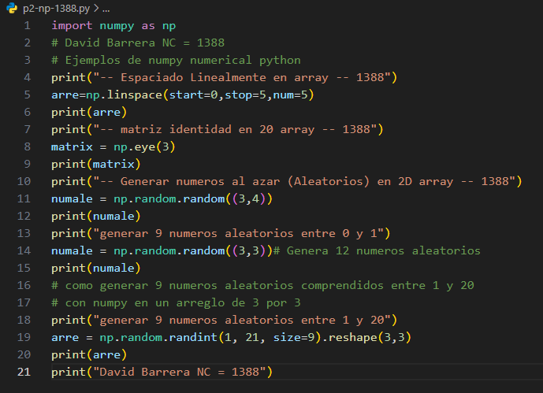
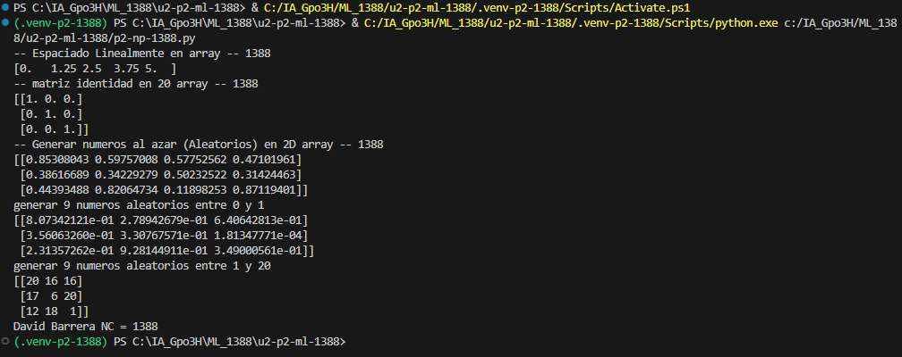

- `start=0` : Define el valor inicial desde donde comienza la secuencia de numeros que se van a generar.

- `stop=1` : Define elvalor final hasta donde llegara la secuencia. Este valor se incluye entre los números generados

- `num=5` : Especifica la cantidad total de números que se generaran entre el valor inicial y el valor final, distrivuidos a intervalos iguales.

## que es np.linespace
- `np.linespace` : np.linespace() es una funcion de Numpy que genera una cantidad determinada de numeros igualmente espaciados entre un valor inicial y un valor final.

## El codigo

## resultados
